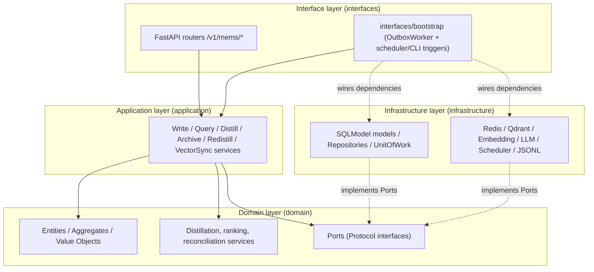
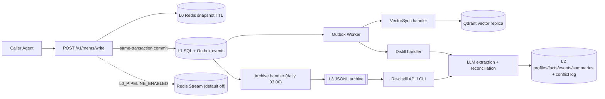
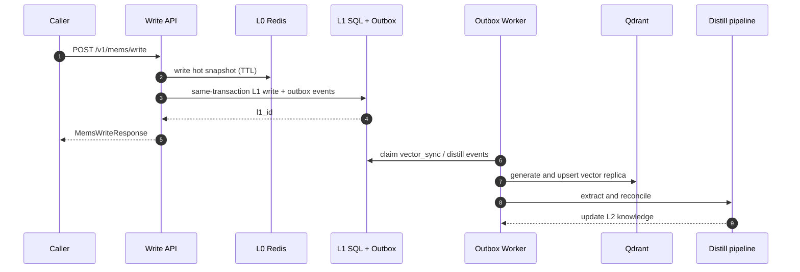
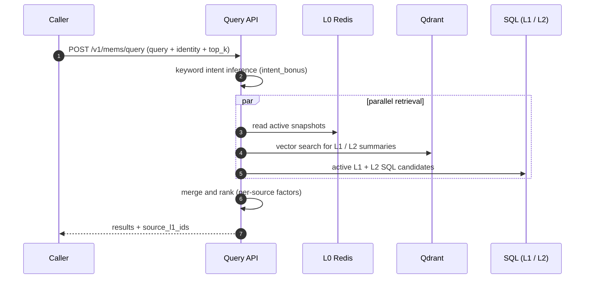
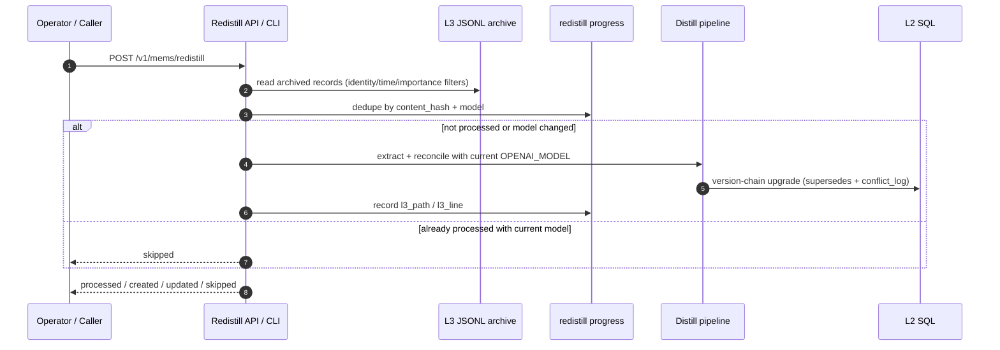
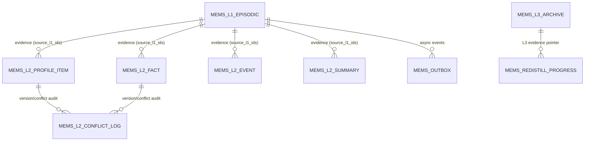

# Architecture Overview

*L0 hot cache → L1 episodic ledger → L2 distilled knowledge → L3 cold archive,
plus a default-off L0 output stream for consumers that bring their own code.*

## Domain Design Architecture

Mems uses a domain-centered layered structure: the interface layer receives HTTP,
scheduler, and CLI triggers; application services orchestrate use cases; the
domain layer owns entities and pure rules and defines ports; infrastructure
implements those ports. Dependencies always point toward the domain layer, and
the composition root (bootstrap) wires concrete implementations into the
application services.

## Four-Layer Design

| Layer | Responsibility | Storage | Key Entities |
| --- | --- | --- | --- |
| `L0` | hot recent-memory cache, fast recall window; never manages runtime state | Redis | `mems:l0:*` snapshots (TTL), `short_term_buffer`, optional stream `mems:l0:events` |
| `L1` | episodic memory ledger: online source of truth, replay and audit | SQL + Qdrant | `mems_l1_episodic`; Qdrant collection `agent_{agent_id}` (derived vector replica) |
| `L2` | distilled long-term knowledge with lineage and versioning | SQL (+ vector index for summaries) | `mems_l2_profile_item`, `mems_l2_fact`, `mems_l2_event`, `mems_l2_summary`, `mems_l2_conflict_log` |
| `L3` | century-scale cold archive, format-portable | JSONL files | `storage/l3_archive/*.jsonl`, `mems_l3_archive` batch metadata |

## Data Flow

- **Remember** (`POST /v1/mems/write`): write the L0 snapshot (TTL), then commit
  the primary `mems_l1_episodic` record together with its outbox events in one
  transaction. The Qdrant vector replica is synced asynchronously by the
  `vector_sync` outbox handler, so the HTTP path stays fast and eventual
  consistency is enforced by the outbox worker. When `L0_PIPELINE_ENABLED=true`,
  a `write`/`append` event is also published to the Redis Stream.
- **Recall** (`POST /v1/mems/query`): read active L0 snapshots across sessions,
  gather L1/L2 SQL candidates, combine with Qdrant vector search, then rank with
  a normalized base (0-1) plus intent weighting and freshness; lexical overlap
  uses CJK bigrams and ASCII words. Archived L1 is excluded by default.
- **Distill** (`L1 → L2`): threshold-triggered through the outbox. Every
  persisted write enqueues a `distill_due` event (deduplicated on the global
  aggregate); when un-distilled L1 records reach `DISTILL_THRESHOLD`
  (default 100), the worker expands it into per-agent `distill_agent` events.
  LLM extraction and reconciliation then create or update profiles, facts,
  events, summaries and conflict logs, and sync summary vectors. Records with
  `importance_score >= DISTILL_HIGH_IMPORTANCE_THRESHOLD` (default 0.8) enqueue
  `distill_agent` directly (batch=1) instead of waiting for the threshold.
  Batches are ordered by importance descending, then creation time. There is no
  scheduled distill job.
- **Archive** (`L1 → L3`): the APScheduler job at 03:00 enqueues `archive_agent`
  events for identities with records older than `ARCHIVE_DAYS`; the outbox worker
  then writes an atomic JSONL batch, records metadata, and marks L1 archived.
- **Re-distill** (`L3 → L2`, manual): `POST /v1/mems/redistill` re-distills
  archived JSONL with the current
  `OPENAI_MODEL`, upgrading L2 via the version chain. Records already processed
  with the same model are skipped (content fingerprint + model), so a model
  upgrade automatically queues old data for re-distillation.
- **L0 Output Pipeline** (default off): consumers use `XREAD` / `XREADGROUP` with
  their own code. Publication is best-effort and never blocks `/write`.
  See [L0 Output Pipeline](../integration/l0-pipeline).

## Components

- **API layer**: FastAPI router under `/v1/mems/*`; dependencies injected via
  `Session`, `RedisService`, `VectorService`, `EmbeddingService`.
- **Application services**: `WriteMemoryService` (Remember), `QueryMemoryService`
  (Recall), `DistillApplicationService` (L1→L2), `ArchiveApplicationService`
  (L1→L3), `VectorSyncApplicationService` (outbox vector sync).
- **Domain layer**: aggregates and value objects for memory identity, L0/L1
  memory, L2 knowledge, L3 archive, and outbox events; distillation, ranking,
  and reconciliation live here as pure domain services.
- **Infrastructure**: Redis/Qdrant/embedding/LLM adapters, SQLModel persistence,
  repositories, and a transactional-outbox `OutboxWorker` that claims events,
  dispatches them, and retries with exponential backoff. Run it in-process or as
  a separate process with `python -m mems.worker`.
- **Identity and namespace**: `tenant_id` / `user_id` / `agent_id` identify the
  memory boundary; `session_id` is optional provenance. The API accepts an
  optional generic `namespace` path for caller context; Mems combines it with
  validated identity into an immutable `MemoryNamespace`. The caller
  application owns business authorization; do not
  rely on `agent_id` alone for multi-user isolation.
- **Failure tolerance**: vector replica sync and stream publication are
  best-effort; distillation and archive run through the outbox worker with status
  columns (`vector_status`, `archive_status`, `is_distilled`, `is_archived`) and
  retry/backoff semantics.

## Flowcharts

Lifecycle overview of a memory from write to distilled knowledge or archive
(the detailed text lives in the Data Flow section above):

## Sequence Diagrams

### Remember: Write and Asynchronous Eventual Consistency

### Recall: Hybrid Recall Across Layers

### Re-distill: L3 → L2

## Database Design

Online memory and pipeline state live in PostgreSQL, grouped by memory layer and
pipeline responsibility:

| Group | Table | Key fields |
| --- | --- | --- |
| L1 episodic ledger | `mems_l1_episodic` | `content`, `messages_json`, `vector_id`, `importance_score`, `is_distilled`, `is_archived`, `vector_status`, `archive_status`, `created_at` |
| L2 profile | `mems_l2_profile_item` | `category`, `key`, `value`, `confidence`, `status`, `source_l1_ids`, `supersedes_id`, `version` |
| L2 fact | `mems_l2_fact` | `subject`, `predicate`, `object`, `fact_type`, `confidence`, `status`, `source_l1_ids`, `supersedes_id`, `version` |
| L2 event | `mems_l2_event` | `subject`, `action`, `object`, `time_hint`, `importance_score`, `source_l1_ids`, `created_at` |
| L2 summary | `mems_l2_summary` | `summary_type`, `content`, `vector_id`, `vector_status`, `source_l1_ids`, `created_at`, `last_verified_at` |
| L2 conflict audit | `mems_l2_conflict_log` | `memory_type`, `old_value`, `new_value`, `resolution`, `reason`, `source_l1_ids` |
| L3 batch metadata | `mems_l3_archive` | identity fields, `time_period`, `file_path`, `record_count`, `archived_at` |
| Re-distill progress | `mems_redistill_progress` | `content_hash`, `model`, `l3_path`, `l3_line`, `processed_at` (unique `content_hash + model`) |
| Pipeline | `mems_outbox` | `event_type`, `aggregate_id`, `payload`, `status`, `attempts`, `owner`, `available_at` |

The following relationships are logical references, not database foreign keys:

- `source_l1_ids` is an array that logically references `mems_l1_episodic.id`
- `supersedes_id` is a self-referencing version-chain column inside profiles/facts
- `l3_path` / `l3_line` point to the evidence location inside an archived JSONL file
- outbox events are aggregated by identity to trigger vector sync, distillation, and archiving

### ER Diagram

## Deployment Notes

- Ports: Mems API `8210`, Qdrant `6333`, Redis `6379`.
- The outbox worker runs inside the app lifespan by default
  (`OUTBOX_WORKER_ENABLED=true`); set it to `false` and run
  `python -m mems.worker` to scale it independently.
- Tests run fully faked (`FakeRedisService`, `FakeVectorService`,
  `FakeEmbeddingService`) — no external services required.
- Distillation needs an OpenAI-compatible LLM configuration; without credentials
  it is skipped.
