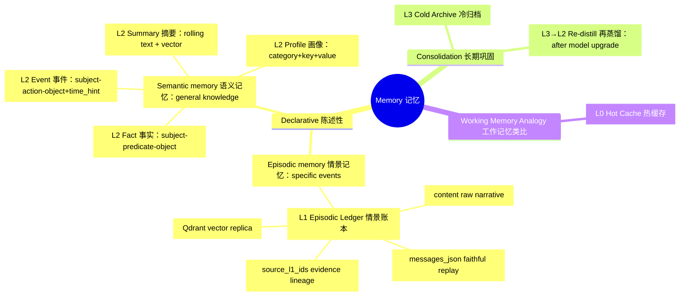

# Architecture Overview

*L0 hot cache → L1 episodic ledger → L2 distilled knowledge → L3 cold archive,
plus a default-off L0 output stream for consumers that bring their own code.*

## Four-Layer Design

| Layer | Responsibility | Storage | Key Entities |
| --- | --- | --- | --- |
| `L0` | hot recent-memory cache, fast recall window; never manages runtime state | Redis | `mems:l0:*` snapshots (TTL), `short_term_buffer`, optional stream `mems:l0:events` |
| `L1` | episodic memory ledger: online source of truth, replay and audit | SQL + Qdrant | `mems_l1_episodic`; Qdrant collection `agent_{agent_id}` (derived vector replica) |
| `L2` | distilled long-term knowledge with lineage and versioning | SQL (+ vector index for summaries) | `mems_l2_profile_item`, `mems_l2_fact`, `mems_l2_event`, `mems_l2_summary`, `mems_l2_conflict_log` |
| `L3` | century-scale cold archive, format-portable | JSONL files | `storage/l3_archive/*.jsonl`, `mems_l3_archive` batch metadata |

## Memory Taxonomy: A Cognitive Science View

Mems borrows the classic cognitive-science taxonomy of human memory systems to
motivate its layered design. Understanding these concepts helps answer "why four
layers, and what question each layer answers".

### Core Concepts

- **Declarative memory**: memories that can be consciously recalled and stated;
  it comprises episodic and semantic memory
  [Squire, 2004](https://doi.org/10.1016/j.nlm.2004.06.005).
- **Episodic memory**: memory of specific events — "what happened, where, and
  when". Endel Tulving first distinguished it from semantic memory in 1972
  [Tulving, 1972](https://en.wikipedia.org/wiki/Episodic_memory), and later
  described it as "mental time travel" — re-experiencing a particular past event
  [Tulving, 2002](https://doi.org/10.1146/annurev.psych.53.100901.135114).
- **Semantic memory**: general knowledge about the world — facts, concepts, and
  word meanings — independent of a specific time and place, and not requiring
  first-hand experience [Tulving, 1972](https://en.wikipedia.org/wiki/Semantic_memory).
- **Memory consolidation**: the process by which newly formed memories become
  stable long-term memories over time
  [Squire & Zola-Morgan, 1991](https://doi.org/10.1126/science.1896849).

### Mapping Cognitive-Science Concepts to Mems

| Cognitive Science Concept | Mems Layer | How the design implements it |
| --- | --- | --- |
| Episodic memory | `L1` episodic ledger (`mems_l1_episodic`) | `content` keeps the raw narrative; `messages_json` preserves structured source messages for faithful replay and audit; `source_l1_ids` provides evidence lineage; the Qdrant vector replica enables semantic recall |
| Semantic memory | `L2` distilled knowledge: profile (`mems_l2_profile_item`), fact (`mems_l2_fact`), event (`mems_l2_event`), summary (`mems_l2_summary`) | Profiles are stable assertions as `category + key + value` (e.g., `preference / coffee / americano` → "the user prefers americano"); facts are entity relations as `subject + predicate + object` triples (e.g., `Mems → uses → Qdrant`); events are structured as `subject + action + object + time_hint` (e.g., `user → completed → onboarding @ 2026-08-01`); summaries are rolling long-term text with a vector replica (e.g., "the user has mainly been writing Mems docs recently") |
| Memory consolidation | `L3` cold archive → `L3→L2` re-distillation | Records older than `ARCHIVE_DAYS` are atomically written to JSONL; after model upgrades, manual re-distillation upgrades L2 knowledge through the version chain |
| Working memory (analogy) | `L0` hot cache | A fast recall window for recent memories (Redis TTL snapshots); never manages runtime state |

> **Design boundary**: Mems uses the cognitive-science taxonomy as an analogy to
> motivate its layered architecture; it does not claim to simulate biological
> memory. Mems only stores and recalls memories; it never manages runtime state.

### Memory Taxonomy Mind Map

### References and Further Reading

- Tulving, E. (1972). *Episodic and semantic memory*. In E. Tulving & W.
  Donaldson (Eds.), *Organization of Memory* (pp. 381–403). Academic Press.
- Tulving, E. (2002). Episodic memory: From mind to brain. *Annual Review of
  Psychology*, 53, 1–25. <https://doi.org/10.1146/annurev.psych.53.100901.135114>
- Squire, L. R. (2004). Memory systems of the brain: A brief history and current
  perspective. *Neurobiology of Learning and Memory*, 82(3), 171–177.
  <https://doi.org/10.1016/j.nlm.2004.06.005>
- Squire, L. R., & Zola-Morgan, S. (1991). The medial temporal lobe memory
  system. *Science*, 253(5026), 1380–1386.
  <https://doi.org/10.1126/science.1896849>
- Wikipedia: [Episodic memory](https://en.wikipedia.org/wiki/Episodic_memory) ·
  [Semantic memory](https://en.wikipedia.org/wiki/Semantic_memory) ·
  [Declarative memory](https://en.wikipedia.org/wiki/Declarative_memory) ·
  [Memory consolidation](https://en.wikipedia.org/wiki/Memory_consolidation)

## Data Flow

- **Remember** (`POST /v1/mems/write`): write the L0 snapshot (TTL), then commit
  the primary `mems_l1_episodic` record together with its outbox events in one
  transaction. The Qdrant vector replica is synced asynchronously by the
  `vector_sync` outbox handler, so the HTTP path stays fast and eventual
  consistency is enforced by the outbox worker. When `L0_PIPELINE_ENABLED=true`,
  a `write`/`append` event is also published to the Redis Stream.
- **Recall** (`POST /v1/mems/query`): read active L0 snapshots across sessions,
  gather L1/L2 SQL candidates, combine with Qdrant vector search, then rank with
  a normalized base (0-1) plus intent weighting and freshness; lexical overlap
  uses CJK bigrams and ASCII words. Archived L1 is excluded by default.
- **Distill** (`L1 → L2`): threshold-triggered through the outbox. Every
  persisted write enqueues a `distill_due` event (deduplicated on the global
  aggregate); when un-distilled L1 records reach `DISTILL_THRESHOLD`
  (default 100), the worker expands it into per-agent `distill_agent` events.
  LLM extraction and reconciliation then create or update profiles, facts,
  events, summaries and conflict logs, and sync summary vectors. Records with
  `importance_score >= DISTILL_HIGH_IMPORTANCE_THRESHOLD` (default 0.8) enqueue
  `distill_agent` directly (batch=1) instead of waiting for the threshold.
  Batches are ordered by importance descending, then creation time. There is no
  scheduled distill job.
- **Archive** (`L1 → L3`): the APScheduler job at 03:00 enqueues `archive_agent`
  events for identities with records older than `ARCHIVE_DAYS`; the outbox worker
  then writes an atomic JSONL batch, records metadata, and marks L1 archived.
- **Re-distill** (`L3 → L2`, manual): `POST /v1/mems/redistill` or
  `python -m mems.redistill` re-distills archived JSONL with the current
  `OPENAI_MODEL`, upgrading L2 via the version chain. Records already processed
  with the same model are skipped (content fingerprint + model), so a model
  upgrade automatically queues old data for re-distillation.
- **L0 Output Pipeline** (default off): consumers use `XREAD` / `XREADGROUP` with
  their own code. Publication is best-effort and never blocks `/write`.
  See [L0 Output Pipeline](../integration/l0-pipeline).

## Components

- **API layer**: FastAPI router under `/v1/mems/*`; dependencies injected via
  `Session`, `RedisService`, `VectorService`, `EmbeddingService`.
- **Application services**: `WriteMemoryService` (Remember), `QueryMemoryService`
  (Recall), `DistillApplicationService` (L1→L2), `ArchiveApplicationService`
  (L1→L3), `VectorSyncApplicationService` (outbox vector sync).
- **Domain layer**: aggregates and value objects for memory identity, L0/L1
  memory, L2 knowledge, L3 archive, and outbox events; distillation, ranking,
  and reconciliation live here as pure domain services.
- **Infrastructure**: Redis/Qdrant/embedding/LLM adapters, SQLModel persistence,
  repositories, and a transactional-outbox `OutboxWorker` that claims events,
  dispatches them, and retries with exponential backoff. Run it in-process or as
  a separate process with `python -m mems.worker`.
- **Isolation**: hard boundaries `tenant_id` / `user_id` / `agent_id`; soft tag
  `scope`; `session_id` is optional provenance. Do not rely on `agent_id` alone
  for multi-user isolation.
- **Failure tolerance**: vector replica sync and stream publication are
  best-effort; distillation and archive run through the outbox worker with status
  columns (`vector_status`, `archive_status`, `is_distilled`, `is_archived`) and
  retry/backoff semantics.

## Deployment Notes

- Ports: Mems API `8210`, Qdrant `6333`, Redis `6379`.
- The outbox worker runs inside the app lifespan by default
  (`OUTBOX_WORKER_ENABLED=true`); set it to `false` and run
  `python -m mems.worker` to scale it independently.
- Tests run fully faked (`FakeRedisService`, `FakeVectorService`,
  `FakeEmbeddingService`) — no external services required.
- Distillation needs an OpenAI-compatible LLM configuration; without credentials
  it is skipped.
