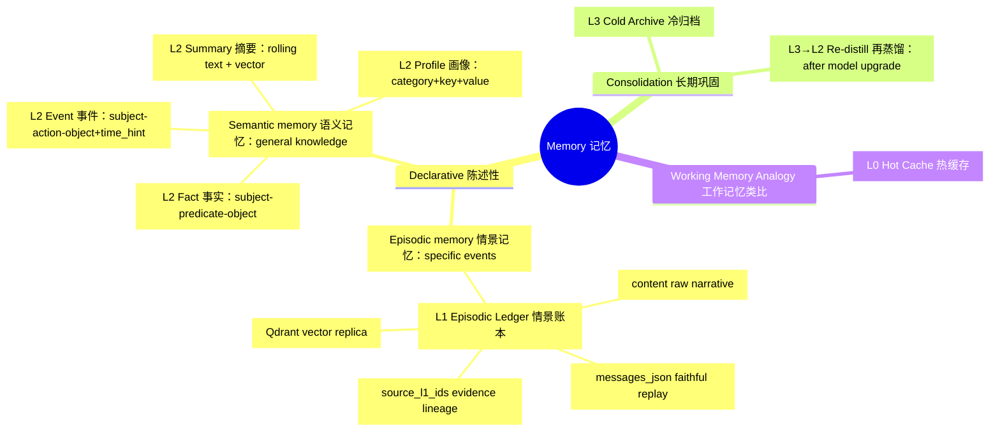

# What Is Mems

Mems is memory infrastructure for AI agents. Through a four-layer hot/cold-decoupled architecture (L0–L3), it gives long-running agents a memory foundation with low-cost retrieval, structured evolution, and century-scale retention.

It addresses a few recurring problems:

- long-running agents keep accumulating noise and struggle to extract signal from experience
- raw conversations pile up without becoming stable, reusable long-term knowledge
- hot cache, historical events, preferences, and archives are mixed together in one fuzzy bucket
- third-party agents lack a unified, well-defined memory API, making integration costly

Mems solves this with four explicit layers:

- `L0` Hot Memory Cache: Redis-backed snapshots of recent sessions deliver millisecond recall of active context
- `L1` Episodic Memory Ledger: SQL is the online source of truth and preserves the original messages; Qdrant holds vector copies, enabling replay, audit, and lineage
- `L2` Distilled Long-Term Knowledge: an LLM pipeline turns L1 narratives into profiles, facts, events, and summaries — stable, reusable semantic knowledge
- `L3` Century-Scale Archive: text-first JSONL keeps ultra-long-term memory readable and portable, and serves as the feedstock for re-distillation

For integrators, the API is simple:

1. `POST /v1/mems/write` — Remember: persist memory content worth keeping
2. `POST /v1/mems/query` — Recall: retrieve relevant memories across L0, L1, and L2

## The Evolution Loop: L3 → L2 Re-Distillation

Archives are not a dead end. L3 JSONL keeps the full raw memory, so archived
records can re-enter the distillation pipeline whenever the underlying model
gets better: run `POST /v1/mems/redistill` (or `python -m mems.redistill`) to
re-extract and reconcile with the current `OPENAI_MODEL`, and upgrade L2
knowledge losslessly through the version chain (`supersedes` + conflict log).
Records are deduplicated by content fingerprint + model, so old data becomes
eligible again automatically after a model upgrade — memory is written once and
can be reborn, layer by layer, as the model improves.

## Memory Taxonomy: A Cognitive Science View

Mems borrows the classic cognitive-science taxonomy of human memory systems to
motivate its layered design. Understanding these concepts helps answer "why four
layers, and what question each layer answers".

### Core Concepts

- **Declarative memory**: memories that can be consciously recalled and stated;
  it comprises episodic and semantic memory
  [Squire, 2004](https://doi.org/10.1016/j.nlm.2004.06.005).
- **Episodic memory**: memory of specific events — "what happened, where, and
  when". Endel Tulving first distinguished it from semantic memory in 1972
  [Tulving, 1972](https://en.wikipedia.org/wiki/Episodic_memory), and later
  described it as "mental time travel" — re-experiencing a particular past event
  [Tulving, 2002](https://doi.org/10.1146/annurev.psych.53.100901.135114).
- **Semantic memory**: general knowledge about the world — facts, concepts, and
  word meanings — independent of a specific time and place, and not requiring
  first-hand experience [Tulving, 1972](https://en.wikipedia.org/wiki/Semantic_memory).
- **Memory consolidation**: the process by which newly formed memories become
  stable long-term memories over time
  [Squire & Zola-Morgan, 1991](https://doi.org/10.1126/science.1896849).

### Mapping Cognitive-Science Concepts to Mems

| Cognitive Science Concept | Mems Layer | How the design implements it |
| --- | --- | --- |
| Episodic memory | `L1` episodic ledger (`mems_l1_episodic`) | `content` keeps the raw narrative; `messages_json` preserves structured source messages for faithful replay and audit; `source_l1_ids` provides evidence lineage; the Qdrant vector replica enables semantic recall |
| Semantic memory | `L2` distilled knowledge: profile (`mems_l2_profile_item`), fact (`mems_l2_fact`), event (`mems_l2_event`), summary (`mems_l2_summary`) | Profiles are stable assertions as `category + key + value` (e.g., `preference / coffee / americano` → "the user prefers americano"); facts are entity relations as `subject + predicate + object` triples (e.g., `Mems → uses → Qdrant`); events are structured as `subject + action + object + time_hint` (e.g., `user → completed → onboarding @ 2026-08-01`); summaries are rolling long-term text with a vector replica (e.g., "the user has mainly been writing Mems docs recently") |
| Memory consolidation | `L3` cold archive → `L3→L2` re-distillation | Records older than `ARCHIVE_DAYS` are atomically written to JSONL; after model upgrades, manual re-distillation upgrades L2 knowledge through the version chain |
| Working memory (analogy) | `L0` hot cache | A fast recall window for recent memories (Redis TTL snapshots); never manages runtime state |

> **Design boundary**: Mems uses the cognitive-science taxonomy as an analogy to
> motivate its layered architecture; it does not claim to simulate biological
> memory. Mems only stores and recalls memories; it never manages runtime state.

### Memory Taxonomy Mind Map

### References and Further Reading

- Tulving, E. (1972). *Episodic and semantic memory*. In E. Tulving & W.
  Donaldson (Eds.), *Organization of Memory* (pp. 381–403). Academic Press.
- Tulving, E. (2002). Episodic memory: From mind to brain. *Annual Review of
  Psychology*, 53, 1–25. <https://doi.org/10.1146/annurev.psych.53.100901.135114>
- Squire, L. R. (2004). Memory systems of the brain: A brief history and current
  perspective. *Neurobiology of Learning and Memory*, 82(3), 171–177.
  <https://doi.org/10.1016/j.nlm.2004.06.005>
- Squire, L. R., & Zola-Morgan, S. (1991). The medial temporal lobe memory
  system. *Science*, 253(5026), 1380–1386.
  <https://doi.org/10.1126/science.1896849>
- Wikipedia: [Episodic memory](https://en.wikipedia.org/wiki/Episodic_memory) ·
  [Semantic memory](https://en.wikipedia.org/wiki/Semantic_memory) ·
  [Declarative memory](https://en.wikipedia.org/wiki/Declarative_memory) ·
  [Memory consolidation](https://en.wikipedia.org/wiki/Memory_consolidation)