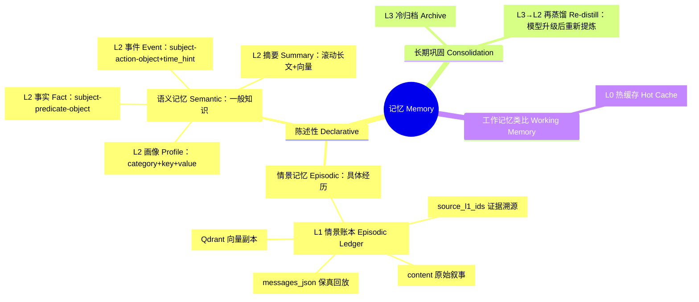

# 架构总览

*L0 热缓存 → L1 情景账本 → L2 蒸馏知识 → L3 冷归档；另有一条默认关闭的 L0
输出流，供自带代码的外部消费者使用。*

## 四层设计

| 层级 | 职责 | 存储 | 关键实体 |
| --- | --- | --- | --- |
| `L0` | 近期热记忆缓存、快速召回窗口；不管理运行时状态 | Redis | `mems:l0:*` 快照（TTL）、`short_term_buffer`、可选流 `mems:l0:events` |
| `L1` | 情景记忆账本：在线事实来源，支持回放与审计 | SQL + Qdrant | `mems_l1_episodic`；Qdrant 集合 `agent_{agent_id}`（派生向量副本） |
| `L2` | 带来源链路与版本管理的蒸馏长期知识 | SQL（+ 摘要向量索引） | `mems_l2_profile_item`、`mems_l2_fact`、`mems_l2_event`、`mems_l2_summary`、`mems_l2_conflict_log` |
| `L3` | 跨世纪冷归档，格式可移植 | JSONL 文件 | `storage/l3_archive/*.jsonl`、`mems_l3_archive` 批次元数据 |

## 记忆分类的认知科学视角

Mems 的分层设计借用了认知科学对记忆系统的经典分类。理解这些概念有助于回答
"为什么是四层、每一层在回答什么问题"。

### 核心概念

- **陈述性记忆（declarative memory）**：能够被有意识地回忆并表述出来的记忆，
  包含情景记忆与语义记忆两类
  [Squire, 2004](https://doi.org/10.1016/j.nlm.2004.06.005)。
- **情景记忆（episodic memory）**：对具体事件的记忆——"某时、某地、经历了
  什么"。Endel Tulving 于 1972 年首次将其与语义记忆区分
  [Tulving, 1972](https://en.wikipedia.org/wiki/Episodic_memory)，2002 年进一步
  将其描述为"心理时间旅行"（mental time travel），即重新体验过去的特定事件
  [Tulving, 2002](https://doi.org/10.1146/annurev.psych.53.100901.135114)。
  中文心理学文献中也译作"情节记忆"。
- **语义记忆（semantic memory）**：关于世界的一般性知识——事实、概念、词义
  等，不依赖特定的时空，也不要求回忆者亲自经历过
  [Tulving, 1972](https://en.wikipedia.org/wiki/Semantic_memory)。
- **记忆巩固（memory consolidation）**：新形成的记忆随时间逐步稳定、转化为
  长期记忆的过程 [Squire & Zola-Morgan,
  1991](https://doi.org/10.1126/science.1896849)。

### 认知科学概念与 Mems 实现的映射

| 认知科学概念 | Mems 对应 | 设计如何实现 |
| --- | --- | --- |
| 情景记忆 | `L1` 情景账本（`mems_l1_episodic`） | `content` 保存原始叙事；`messages_json` 保留结构化原文用于保真回放与审计；`source_l1_ids` 提供证据溯源；Qdrant 向量副本支持语义召回 |
| 语义记忆 | `L2` 蒸馏知识：画像（`mems_l2_profile_item`）、事实（`mems_l2_fact`）、事件（`mems_l2_event`）、摘要（`mems_l2_summary`） | 画像 = `category + key + value` 稳定断言（例：`preference / coffee / 美式` → "用户偏好美式咖啡"）；事实 = `subject + predicate + object` 三元组（例：`Mems → uses → Qdrant`）；事件 = `subject + action + object + time_hint`（例：`user → completed → onboarding @ 2026-08-01`）；摘要 = 滚动长文 + 向量副本（例："用户近期主要在参与 Mems 文档写作"） |
| 记忆巩固 | `L3` 冷归档 → `L3→L2` 再蒸馏 | 超过 `ARCHIVE_DAYS` 的记录原子写入 JSONL 归档；模型升级后手动再蒸馏，通过版本链升级 L2 知识 |
| 工作记忆（类比） | `L0` 热缓存 | 近期记忆的快速召回窗口（Redis TTL 快照），不管理运行时状态 |

> **设计边界**：Mems 借用认知科学的分类来启发分层架构，是一种设计隐喻，
> 并不声称模拟生物记忆系统。Mems 只负责存储和召回记忆，不管理运行时状态。

### 记忆分类思维导图

### 参考文献与扩展阅读

- Tulving, E. (1972). *Episodic and semantic memory*. In E. Tulving & W.
  Donaldson (Eds.), *Organization of Memory* (pp. 381–403). Academic Press.
- Tulving, E. (2002). Episodic memory: From mind to brain. *Annual Review of
  Psychology*, 53, 1–25. <https://doi.org/10.1146/annurev.psych.53.100901.135114>
- Squire, L. R. (2004). Memory systems of the brain: A brief history and current
  perspective. *Neurobiology of Learning and Memory*, 82(3), 171–177.
  <https://doi.org/10.1016/j.nlm.2004.06.005>
- Squire, L. R., & Zola-Morgan, S. (1991). The medial temporal lobe memory
  system. *Science*, 253(5026), 1380–1386.
  <https://doi.org/10.1126/science.1896849>
- Wikipedia: [Episodic memory](https://en.wikipedia.org/wiki/Episodic_memory) ·
  [Semantic memory](https://en.wikipedia.org/wiki/Semantic_memory) ·
  [Declarative memory](https://en.wikipedia.org/wiki/Declarative_memory) ·
  [Memory consolidation](https://en.wikipedia.org/wiki/Memory_consolidation)

## 数据流

- **写入（Remember）**（`POST /v1/mems/write`）：写入 L0 快照（TTL）→
  `sync_l0_to_l1` 落库 `mems_l1_episodic`，并尽力同步 Qdrant 向量副本；
  当 `L0_PIPELINE_ENABLED=true` 时还会向 Redis Stream 发布 `write`/`append` 事件。
- **召回（Recall）**（`POST /v1/mems/query`）：读取 L0 跨会话活跃快照，汇总
  L1/L2 SQL 候选，结合 Qdrant 向量检索，再按归一化 base（0-1）+ 意图权重 +
  新鲜度排序；词法重叠使用 CJK bigram + ASCII 整词。默认排除已归档 L1。
- **蒸馏（L1 → L2）**：阈值触发。每次成功写入后，后台任务检查未蒸馏记录；
  达到 `DISTILL_THRESHOLD`（默认 100）即执行 LLM 提取与对账，创建/更新画像、
  事实、事件、摘要与冲突日志，并同步摘要向量。`importance_score >=
  DISTILL_HIGH_IMPORTANCE_THRESHOLD`（默认 0.8）的记录写入后立即蒸馏
  （batch=1），不等待全局阈值；批内按重要度降序、创建时间升序取数。
  无定时蒸馏任务。
- **归档（L1 → L3）**：APScheduler 每日 03:00 将早于 `ARCHIVE_DAYS` 的记录
  原子写入 JSONL 批次、登记元数据，并标记 L1 已归档。
- **再蒸馏（L3 → L2，手动）**：`POST /v1/mems/redistill` 或
  `python -m mems.redistill` 用当前 `OPENAI_MODEL` 重蒸归档 JSONL，通过版本链
  升级 L2；同一模型已处理的记录按内容指纹跳过，模型升级后旧数据自动进入待重蒸队列。
- **L0 输出管道**（默认关闭）：消费者用 `XREAD` / `XREADGROUP` 配合自己的代码
  消费事件；发布为尽力而为，绝不阻断 `/write`。详见
  [L0 输出管道](../integration/l0-pipeline)。

## 组件

- **API 层**：FastAPI 路由统一挂在 `/v1/mems/*`；依赖注入
  `Session`、`RedisService`、`VectorService`、`EmbeddingService`。
- **服务层**：`redis_service`（L0）、`l0_sync`（L0→L1）、`vector_service`
  （Qdrant 异步 SDK）、`embedding`（sentence-transformers 或 openai）、
  `llm_client`（OpenAI-compatible）、`distill`、`archive`、`scheduler`
  （APScheduler 单例）、`jsonl_utils`。
- **隔离模型**：硬边界 `tenant_id` / `user_id` / `agent_id`；软标签 `scope`；
  `session_id` 为可选溯源。多用户隔离不能只依赖 `agent_id`。
- **失败容忍**：向量副本同步与流发布均为尽力而为；蒸馏、归档在后台执行，
  以状态列跟踪（`vector_status`、`archive_status`、`is_distilled`、`is_archived`）。

## 部署说明

- 端口：Mems API `8210`、Qdrant `6333`、Redis `6379`。
- 测试全部使用 Fake 注入（`FakeRedisService`、`FakeVectorService`、
  `FakeEmbeddingService`），无需外部服务。
- 蒸馏依赖 OpenAI-compatible LLM 配置；无凭据时自动跳过。
