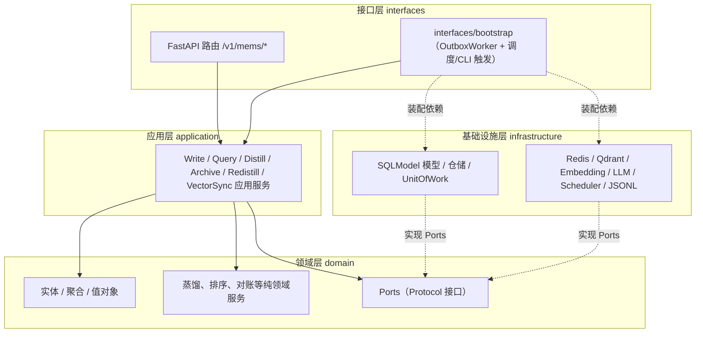
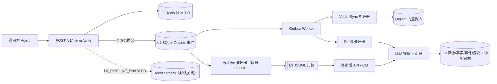
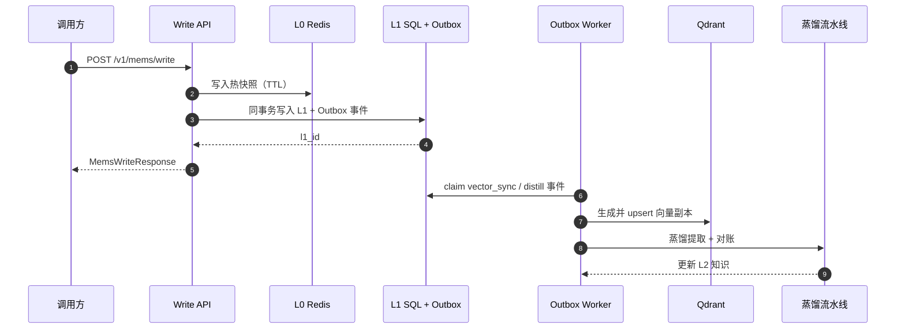
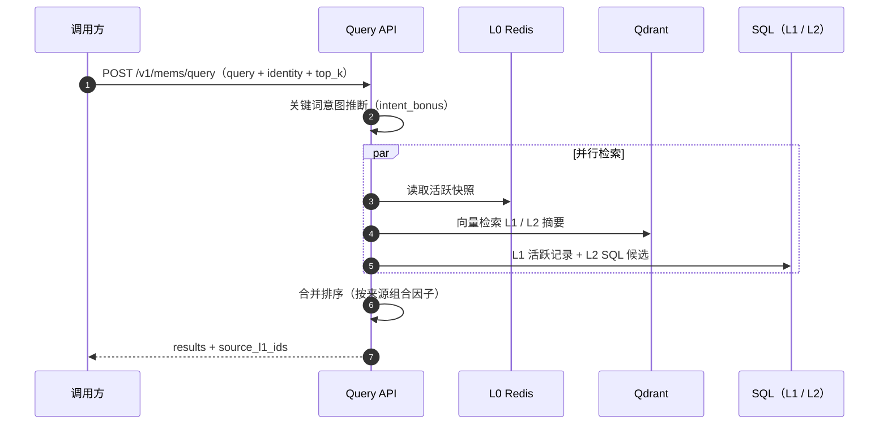
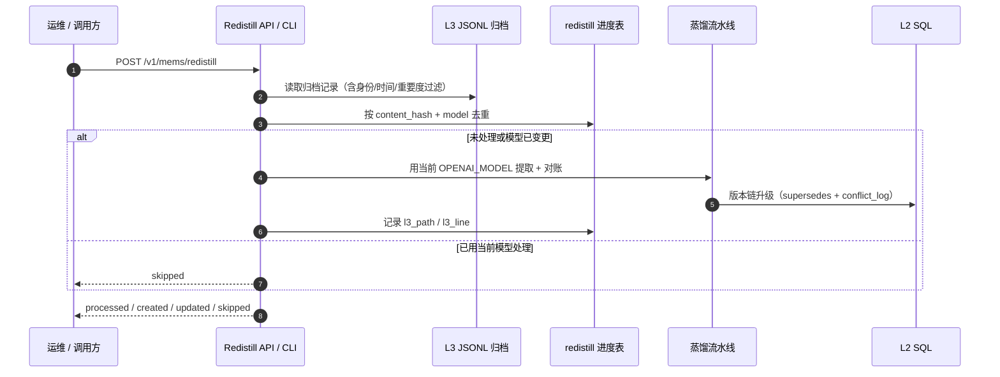
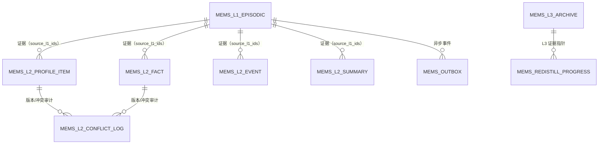

# 架构总览

*L0 热缓存 → L1 情景账本 → L2 蒸馏知识 → L3 冷归档；另有一条默认关闭的 L0
输出流，供自带代码的外部消费者使用。*

## 领域设计架构图

Mems 采用领域中心的分层结构：接口层接收 HTTP、调度与 CLI 触发，应用层编排
用例，领域层承载实体与纯规则并定义端口，基础设施层实现这些端口。依赖方向始终
指向领域层；组合根（bootstrap）负责把具体实现装配进应用服务。

## 四层设计

| 层级 | 职责 | 存储 | 关键实体 |
| --- | --- | --- | --- |
| `L0` | 近期热记忆缓存、快速召回窗口；不管理运行时状态 | Redis | `mems:l0:*` 快照（TTL）、`short_term_buffer`、可选流 `mems:l0:events` |
| `L1` | 情景记忆账本：在线事实来源，支持回放与审计 | SQL + Qdrant | `mems_l1_episodic`；Qdrant 集合 `agent_{agent_id}`（派生向量副本） |
| `L2` | 带来源链路与版本管理的蒸馏长期知识 | SQL（+ 摘要向量索引） | `mems_l2_profile_item`、`mems_l2_fact`、`mems_l2_event`、`mems_l2_summary`、`mems_l2_conflict_log` |
| `L3` | 跨世纪冷归档，格式可移植 | JSONL 文件 | `storage/l3_archive/*.jsonl`、`mems_l3_archive` 批次元数据 |

## 数据流

- **写入（Remember）**（`POST /v1/mems/write`）：写入 L0 快照（TTL），然后在
  同一事务中提交主记录 `mems_l1_episodic` 及其 Outbox 事件。Qdrant 向量副本由
  `vector_sync` Outbox 处理器异步同步，HTTP 路径保持快速，最终一致性由 Outbox
  worker 保证。当 `L0_PIPELINE_ENABLED=true` 时，还会向 Redis Stream 发布
  `write`/`append` 事件。
- **召回（Recall）**（`POST /v1/mems/query`）：读取 L0 跨会话活跃快照，汇总
  L1/L2 SQL 候选，结合 Qdrant 向量检索，再按归一化 base（0-1）+ 意图权重 +
  新鲜度排序；词法重叠使用 CJK bigram + ASCII 整词。默认排除已归档 L1。
- **蒸馏（L1 → L2）**：通过 Outbox 阈值触发。每次成功写入都会 enqueue 一个
  `distill_due` 事件（按 global 聚合去重）；当未蒸馏 L1 记录达到
  `DISTILL_THRESHOLD`（默认 100）时，worker 将其展开为按 agent 的
  `distill_agent` 事件。随后 LLM 提取与对账创建/更新画像、事实、事件、摘要与
  冲突日志，并同步摘要向量。`importance_score >=
  DISTILL_HIGH_IMPORTANCE_THRESHOLD`（默认 0.8）的记录会直接 enqueue
  `distill_agent`（batch=1），不等待全局阈值；批内按重要度降序、创建时间升序
  取数。无定时蒸馏任务。
- **归档（L1 → L3）**：APScheduler 每日 03:00 为早于 `ARCHIVE_DAYS` 的记录身份
  enqueue `archive_agent` 事件；Outbox worker 随后原子写入 JSONL 批次、登记
  元数据，并标记 L1 已归档。
- **再蒸馏（L3 → L2，手动）**：`POST /v1/mems/redistill` 或
  `python -m mems.redistill` 用当前 `OPENAI_MODEL` 重蒸归档 JSONL，通过版本链
  升级 L2；同一模型已处理的记录按内容指纹跳过，模型升级后旧数据自动进入待重蒸队列。
- **L0 输出管道**（默认关闭）：消费者用 `XREAD` / `XREADGROUP` 配合自己的代码
  消费事件；发布为尽力而为，绝不阻断 `/write`。详见
  [L0 输出管道](../integration/l0-pipeline)。

## 组件

- **API 层**：FastAPI 路由统一挂在 `/v1/mems/*`；依赖注入
  `Session`、`RedisService`、`VectorService`、`EmbeddingService`。
- **应用服务**：`WriteMemoryService`（写入）、`QueryMemoryService`（召回）、
  `DistillApplicationService`（L1→L2）、`ArchiveApplicationService`（L1→L3）、
  `VectorSyncApplicationService`（Outbox 向量同步）。
- **领域层**：记忆身份、L0/L1 记忆、L2 知识、L3 归档与 Outbox 事件的聚合与
  值对象；蒸馏、排序、对账作为纯领域服务放在这里。
- **基础设施层**：Redis/Qdrant/embedding/LLM 适配器、SQLModel 持久化、仓储，
  以及事务性 Outbox 的 `OutboxWorker`，负责 claim 事件、分发处理并按指数退避
  重试。可在进程内运行，也可通过 `python -m mems.worker` 独立部署。
- **隔离模型**：硬边界 `tenant_id` / `user_id` / `agent_id`；软标签 `scope`；
  `session_id` 为可选溯源。多用户隔离不能只依赖 `agent_id`。
- **失败容忍**：向量副本同步与流发布均为尽力而为；蒸馏、归档在后台执行，
  由 Outbox worker 通过状态列（`vector_status`、`archive_status`、
  `is_distilled`、`is_archived`）与重试/退避语义保证最终一致。

## 流程图

一张记忆从写入到沉淀/归档的异步生命周期总览（详细文字见上节「数据流」）：

## 时序图

### Remember：写入与异步最终一致

### Recall：跨层混合召回

### Re-distill：L3 → L2 再蒸馏

## 数据库设计

在线记忆与运营状态统一落在 PostgreSQL，按记忆层次与流水线职责分组：

| 分组 | 表 | 关键字段 |
| --- | --- | --- |
| L1 情景账本 | `mems_l1_episodic` | `content`、`messages_json`、`vector_id`、`importance_score`、`is_distilled`、`is_archived`、`vector_status`、`archive_status`、`created_at` |
| L2 画像 | `mems_l2_profile_item` | `category`、`key`、`value`、`confidence`、`status`、`source_l1_ids`、`supersedes_id`、`version` |
| L2 事实 | `mems_l2_fact` | `subject`、`predicate`、`object`、`fact_type`、`confidence`、`status`、`source_l1_ids`、`supersedes_id`、`version` |
| L2 事件 | `mems_l2_event` | `subject`、`action`、`object`、`time_hint`、`importance_score`、`source_l1_ids`、`created_at` |
| L2 摘要 | `mems_l2_summary` | `summary_type`、`content`、`vector_id`、`vector_status`、`source_l1_ids`、`created_at`、`last_verified_at` |
| L2 冲突审计 | `mems_l2_conflict_log` | `memory_type`、`old_value`、`new_value`、`resolution`、`reason`、`source_l1_ids` |
| L3 批次元数据 | `mems_l3_archive` | identity 字段、`time_period`、`file_path`、`record_count`、`archived_at` |
| 再蒸馏进度 | `mems_redistill_progress` | `content_hash`、`model`、`l3_path`、`l3_line`、`processed_at`（唯一 `content_hash + model`） |
| 流水线 | `mems_outbox` | `event_type`、`aggregate_id`、`payload`、`status`、`attempts`、`owner`、`available_at` |

以下为逻辑关系示意，不代表数据库外键约束：

- `source_l1_ids` 以数组形式逻辑引用 `mems_l1_episodic.id`
- `supersedes_id` 是 profile/fact 表内的版本链自引用
- `l3_path` / `l3_line` 指向归档 JSONL 的证据位置
- outbox 事件按身份聚合触发向量同步、蒸馏与归档

### ER图

## 部署说明

- 端口：Mems API `8210`、Qdrant `6333`、Redis `6379`。
- Outbox worker 默认在应用 lifespan 内运行（`OUTBOX_WORKER_ENABLED=true`）；
  设为 `false` 后可通过 `python -m mems.worker` 独立部署以水平扩展。
- 测试全部使用 Fake 注入（`FakeRedisService`、`FakeVectorService`、
  `FakeEmbeddingService`），无需外部服务。
- 蒸馏依赖 OpenAI-compatible LLM 配置；无凭据时自动跳过。
