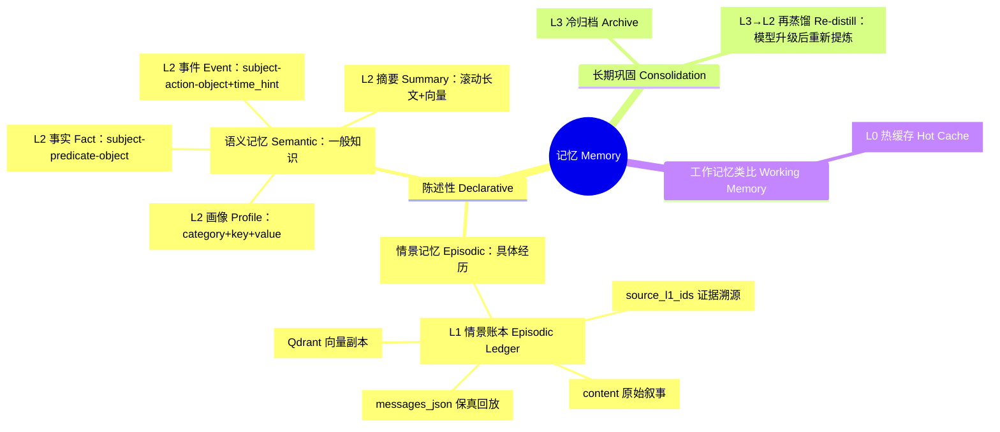

# 什么是 Mems

Mems 是面向 AI Agent 的记忆基础设施。通过 L0–L3 四层冷热解耦架构，为长期运行的 Agent 提供低成本检索、结构化进化与跨世纪保存的记忆基座。

它解决的核心问题是：

- 长期运行的 Agent 持续产生噪声，难以从经历中提取有效信号
- 原始对话大量堆积，难以沉淀为稳定、可复用的长期知识
- 热记忆、历史事件、用户偏好与长期归档混在同一个 memory bucket，召回边界模糊
- 第三方 Agent 缺少统一、清晰的记忆 API，接入成本高

Mems 用四层架构解决这个问题：

- `L0` 热记忆缓存：Redis 承载近期会话快照，毫秒级召回活跃上下文
- `L1` 情景记忆账本：以 SQL 为在线真相源并保留原始消息，Qdrant 提供向量副本，支持回放、审计与溯源
- `L2` 蒸馏长期知识：LLM 流水线把 L1 叙事提炼为画像、事实、事件与摘要，形成稳定、可复用的语义知识
- `L3` 跨世纪归档：以 Text-First JSONL 持久化超长期记忆，可读、可迁移，同时作为再蒸馏的原料库

对接入方来说，API 很简单：

1. `POST /v1/mems/write` — Remember：把值得记住的内容写入记忆
2. `POST /v1/mems/query` — Recall：跨 L0/L1/L2 召回相关记忆

## 进化闭环：L3 → L2 再蒸馏

归档不是终点。L3 JSONL 完整保留原始记忆，因此当底层模型变得更强时，旧记忆可以
随时重新进入蒸馏流水线：通过 `POST /v1/mems/redistill`（或
`python -m mems.redistill`）用当前 `OPENAI_MODEL` 重新提取与对账，经版本链
（`supersedes` + 冲突日志）无损升级 L2 长期知识。记录按「内容指纹 + 模型名」
去重，模型升级后旧数据会自动重新具备再蒸馏资格——记忆只写一次，却能在模型
进步时层层重生。

## 记忆分类的认知科学视角

Mems 的分层设计借用了认知科学对记忆系统的经典分类。理解这些概念有助于回答
"为什么是四层、每一层在回答什么问题"。

### 核心概念

- **陈述性记忆（declarative memory）**：能够被有意识地回忆并表述出来的记忆，
  包含情景记忆与语义记忆两类
  [Squire, 2004](https://doi.org/10.1016/j.nlm.2004.06.005)。
- **情景记忆（episodic memory）**：对具体事件的记忆——"某时、某地、经历了
  什么"。Endel Tulving 于 1972 年首次将其与语义记忆区分
  [Tulving, 1972](https://en.wikipedia.org/wiki/Episodic_memory)，2002 年进一步
  将其描述为"心理时间旅行"（mental time travel），即重新体验过去的特定事件
  [Tulving, 2002](https://doi.org/10.1146/annurev.psych.53.100901.135114)。
  中文心理学文献中也译作"情节记忆"。
- **语义记忆（semantic memory）**：关于世界的一般性知识——事实、概念、词义
  等，不依赖特定的时空，也不要求回忆者亲自经历过
  [Tulving, 1972](https://en.wikipedia.org/wiki/Semantic_memory)。
- **记忆巩固（memory consolidation）**：新形成的记忆随时间逐步稳定、转化为
  长期记忆的过程 [Squire & Zola-Morgan,
  1991](https://doi.org/10.1126/science.1896849)。

### 认知科学概念与 Mems 实现的映射

| 认知科学概念 | Mems 对应 | 设计如何实现 |
| --- | --- | --- |
| 情景记忆 | `L1` 情景账本（`mems_l1_episodic`） | `content` 保存原始叙事；`messages_json` 保留结构化原文用于保真回放与审计；`source_l1_ids` 提供证据溯源；Qdrant 向量副本支持语义召回 |
| 语义记忆 | `L2` 蒸馏知识：画像（`mems_l2_profile_item`）、事实（`mems_l2_fact`）、事件（`mems_l2_event`）、摘要（`mems_l2_summary`） | 画像 = `category + key + value` 稳定断言（例：`preference / coffee / 美式` → "用户偏好美式咖啡"）；事实 = `subject + predicate + object` 三元组（例：`Mems → uses → Qdrant`）；事件 = `subject + action + object + time_hint`（例：`user → completed → onboarding @ 2026-08-01`）；摘要 = 滚动长文 + 向量副本（例："用户近期主要在参与 Mems 文档写作"） |
| 记忆巩固 | `L3` 冷归档 → `L3→L2` 再蒸馏 | 超过 `ARCHIVE_DAYS` 的记录原子写入 JSONL 归档；模型升级后手动再蒸馏，通过版本链升级 L2 知识 |
| 工作记忆（类比） | `L0` 热缓存 | 近期记忆的快速召回窗口（Redis TTL 快照），不管理运行时状态 |

> **设计边界**：Mems 借用认知科学的分类来启发分层架构，是一种设计隐喻，
> 并不声称模拟生物记忆系统。Mems 只负责存储和召回记忆，不管理运行时状态。

### 记忆分类思维导图

### 参考文献与扩展阅读

- Tulving, E. (1972). *Episodic and semantic memory*. In E. Tulving & W.
  Donaldson (Eds.), *Organization of Memory* (pp. 381–403). Academic Press.
- Tulving, E. (2002). Episodic memory: From mind to brain. *Annual Review of
  Psychology*, 53, 1–25. <https://doi.org/10.1146/annurev.psych.53.100901.135114>
- Squire, L. R. (2004). Memory systems of the brain: A brief history and current
  perspective. *Neurobiology of Learning and Memory*, 82(3), 171–177.
  <https://doi.org/10.1016/j.nlm.2004.06.005>
- Squire, L. R., & Zola-Morgan, S. (1991). The medial temporal lobe memory
  system. *Science*, 253(5026), 1380–1386.
  <https://doi.org/10.1126/science.1896849>
- Wikipedia: [Episodic memory](https://en.wikipedia.org/wiki/Episodic_memory) ·
  [Semantic memory](https://en.wikipedia.org/wiki/Semantic_memory) ·
  [Declarative memory](https://en.wikipedia.org/wiki/Declarative_memory) ·
  [Memory consolidation](https://en.wikipedia.org/wiki/Memory_consolidation)